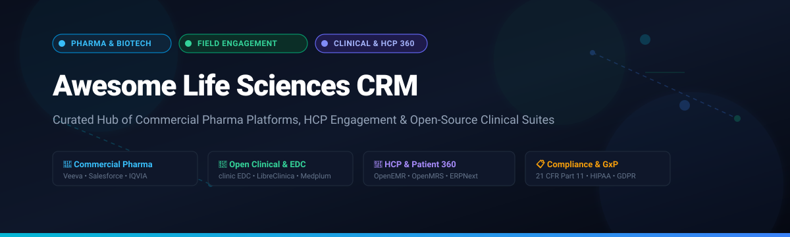

  

# 🧬 Awesome Life Sciences CRM & Pharma HCP Engagement 🩺

  
  
  
  
  
  
  

> 💡 **A community-curated collection of leading commercial SaaS platforms, open-source Electronic Data Capture (EDC) systems, Clinical Data Management (CDM) tools, and Healthcare Provider (HCP) engagement solutions tailored for biotechnology, pharmaceutical enterprises, and clinical research organizations.**

---

## 📑 Table of Contents

- [📊 Sector Overview & Market Dynamics](#-sector-overview--market-dynamics)
- [🏢 SaaS & Hosted Enterprise Platforms](#-saas--hosted-enterprise-platforms)
- [💻 Open-Source GitHub Projects](#-open-source-github-projects)
- [🔬 Additional Open-Source & Framework Options](#-additional-open-source--framework-options)
- [🤝 How to Contribute](#-how-to-contribute)
- [💖 Support & Sponsorship](#-support--sponsorship)
- [📈 Star History](#-star-history)
- [⚖️ Disclaimer](#-disclaimer)

---

## 📊 Sector Overview & Market Dynamics

The global **Life Sciences CRM market** was valued at approximately **$3.8 billion to $4.2 billion in 2024** and is projected to surpass **$7.5 billion by 2030**, exhibiting a robust compound annual growth rate (**CAGR of ~11.5%**).

Historically, the industry has operated as a **moderately-to-highly concentrated, near-duopolistic market** where category incumbents like **Veeva Systems** and **IQVIA** captured the lion's share of global pharmaceutical commercial deployments. However, the sector is experiencing intense market dynamics following Veeva's transition from Salesforce to its proprietary Vault platform, prompting **Salesforce** to roll out its dedicated Life Sciences Cloud. Simultaneously, specialized AI-driven engagement providers and flexible open-source healthcare platforms are rapidly unbundling point solutions for niche biotechs, clinical trials, and data-sovereign medical research.

---

## 🏢 SaaS & Hosted Enterprise Platforms

| 🏢 Platform | 💰 Company Valuation / Revenue | 🏷️ Specific Starting Pricing | 🎁 Free Tier & Trial Limits | 🔍 Key Focus & Capabilities |
| :--- | :--- | :--- | :--- | :--- |
| **[Salesforce Life Sciences Cloud](https://www.salesforce.com/solutions/industries/life-sciences/)** | ~$310B Market Cap (~$34.9B ARR) | From **$325 / user / month** (billed annually for Life Sciences Cloud Enterprise Edition) | **30-day full feature trial** (Includes pre-configured demo org, sample HCP data, and Einstein AI preview; max 5 users) | Native Einstein 1 AI platform, clinical trial operations, Medical Affairs HCP engagement, and seamless Data Cloud integration. |
| **[IQVIA Orchestrated Customer Engagement](https://www.iqvia.com/solutions/commercialization/commercial-technology/customer-engagement)** | ~$40B Market Cap (~$15.0B ARR) | From **$250 / user / month** (base enterprise subscription with contract minimums) | **No self-serve free tier**; 30-day proof-of-concept sandbox offered upon enterprise qualification | Commercial orchestrator integrating IMS real-world health data, multichannel rep coordination, and medical compliance. |
| **[Veeva CRM / Vault CRM](https://www.veeva.com/products/vault-crm/)** | ~$35B Market Cap (~$2.6B ARR) | From **$200 / user / month** (Vault CRM commercial base licensing) | **No self-serve free tier**; 14-day guided sandbox access provided through Veeva Services for enterprise pilots | The dominant pharmaceutical CRM standard with closed-loop marketing (CLM), sample tracking, and 21 CFR Part 11 auditing. |
| **[Model N](https://www.modeln.com/)** | ~$1.25B Valuation (Acquired by Vista Equity) | From **$1,500 / month** (starting tier for Revenue Cloud module contracts) | **No free tier**; 14-day staging proof-of-concept sandbox available upon scheduled commercial demo | Enterprise revenue management, gross-to-net tracking, regulatory pricing, and channel incentives for pharma/medtech. |
| **[Aktana](https://www.aktana.com/)** | ~$400M Valuation (Enterprise Venture-backed) | From **$120 / user / month** (Contextual Intelligence platform add-on) | **No permanent free tier**; 30-day pilot sandbox environment for qualified commercial teams | AI-driven Next Best Action (NBA) decision engine that integrates with core CRMs to recommend multi-channel field rep actions. |
| **[Pitcher Life Sciences](https://www.pitcher.com/)** | ~$150M Valuation (Part of Agnitio / Private Equity) | From **$85 / user / month** (Interactive sales enablement starting tier) | **14-day free trial** (Full mobile CLM tablet application, up to 3 sales rep profiles and demo content deck) | Closed-loop marketing (CLM), interactive e-detailing on tablets, and multi-channel field representative enablement. |
| **[WhizAI](https://www.whiz.ai/)** | ~$100M Valuation (Series A/B Venture-backed) | From **$75 / user / month** (Hybrid seat + compute baseline package) | **14-day interactive guided trial** (Pre-loaded with sample pharmaceutical field data and conversational querying) | Domain-tailored conversational AI and real-time business intelligence for commercial pharma and sales operations. |
| **[Exeevo](https://www.exeevo.com/)** | ~$80M Valuation (Strategic backing by BC Platforms & Microsoft) | From **$95 / user / month** (Omnipresence commercial customer suite) | **30-day sandbox trial** (Includes demo HCP directory, event management, and Microsoft Teams integration; max 5 test users) | Microsoft Cloud for Healthcare partner CRM offering omnichannel customer engagement, digital medical events, and rep portals. |
| **[Platforce](https://platforce.com/)** | ~$25M Valuation (Growth-stage venture backing) | From **$49 / user / month** (Standard Cloud tier for pharmaceutical reps) | **14-day full feature free trial** (No credit card required; access to CLM presentations, HCP database, and 2 rep licenses) | Agile, compliant life sciences CRM built for emerging pharma and biotechs, featuring e-detailing and remote call recording. |
| **[Trueblue](https://www.trueblue.com/)** | ~$20M Valuation (Privately held life sciences IT) | From **$65 / user / month** (AiDAP & CRM integration suite) | **14-day trial sandbox** (Access to smart AI advisor module and demo sample tracking for up to 3 evaluation users) | Pragmatic, relationship-focused pharmaceutical CRM featuring AI-powered operational dashboards and medical CRM workflows. |

---

## 💻 Open-Source GitHub Projects

The following open-source solutions cover clinical trials data capture, electronic healthcare record management, laboratory automation, and pharmaceutical customer relationship workflows.

*Sorted by GitHub_Stars in descending order:*

- **[ERPNext](https://github.com/frappe/erpnext)**   
  Full-featured open-source ERP system featuring integrated CRM, inventory, distribution, and specialized healthcare & laboratory management modules. Actively adapted by pharmaceutical consulting firms and medical device distributors to manage HCP networks, client pipelines, and batch tracking.  
  *Stack: Python, Frappe Framework, MariaDB, Redis.*

- **[OpenEMR](https://github.com/openemr/openemr)**   
  ONC-certified open-source electronic health records (EHR) and healthcare practice management system. Features comprehensive patient charting, e-prescribing, medical scheduling, and patient engagement portals with full HIPAA compliance.  
  *Stack: PHP, MySQL, JavaScript.*

- **[Medplum](https://github.com/medplum/medplum)**   
  Developer-first, headless open-source healthcare platform and programmable EHR/CRM backend built natively on the HL7® FHIR standard. Ideal for clinical trial recruitment pipelines, diagnostic workflows, and custom life sciences patient/provider portals.  
  *Stack: TypeScript, React, Node.js, PostgreSQL.*

- **[OpenMRS Core](https://github.com/openmrs/openmrs-core)**   
  World-renowned open-source enterprise clinical data repository and electronic medical record platform. Extensively deployed globally to support medical longitudinal trials, observational cohorts, and institutional patient care tracking.  
  *Stack: Java, Spring Framework, Hibernate, MySQL.*

- **[SENAITE Core](https://github.com/senaite/senaite.core)**   
  Enterprise-grade, open-source Laboratory Information Management System (LIMS) designed for clinical, biotech, and biobank research laboratories. Provides strict chain-of-custody tracking, sample lifecycle management, and ISO 17025 compliance workflows.  
  *Stack: Python, Plone, Zope.*

- **[NEMO (NIST)](https://github.com/usnistgov/NEMO)**   
  Laboratory logistics and resource management system developed at the National Institute of Standards and Technology (NIST). Manages research tool scheduling, laboratory personnel access, maintenance billing, and consumable tracking.  
  *Stack: Python, Django, PostgreSQL.*

- **[Sequencescape](https://github.com/sanger/sequencescape)**   
  Scalable open-source laboratory sample and workflow management platform engineered by the Wellcome Sanger Institute for high-throughput genomic sequencing pipelines and bio-sample tracking.  
  *Stack: Ruby on Rails, MySQL.*

- **[openCRX](https://github.com/opencrx/opencrx)**   
  Enterprise-class CRM offering multi-entity customer management, sales force automation, contract management, and complex workflow pipelines. Extensively tailored for pharmaceutical, chemical, and medical devices sales operations.  
  *Stack: Java, OpenMDX, PostgreSQL / Oracle.*

- **[LibreClinica](https://github.com/reliatec-gmbh/LibreClinica)**   
  The community-governed open-source Electronic Data Capture (EDC) and Clinical Data Management (CDM) system, branched from OpenClinica. Supports eCRF builders, audited study protocols, and regulatory 21 CFR Part 11 compliant data exports.  
  *Stack: Java, Tomcat, PostgreSQL.*

- **[Akello](https://github.com/akello-io/akello)**   
  Modern open-source measurement-based care and clinical registry platform connecting care managers, consulting clinicians, and patient populations for integrated behavioral and chronic health trials.  
  *Stack: Python, FastAPI, React, AWS DynamoDB.*

- **[clinic EDC](https://github.com/clinicedc/clinicedc)**   
  Clinical trials Electronic Data Capture (EDC) framework for multi-site randomized longitudinal trials. Leveraged by Harvard T.H. Chan School of Public Health and the London School of Hygiene & Tropical Medicine for global clinical research.  
  *Stack: Python, Django, MySQL.*

- **[restructure](https://github.com/consected/restructure)**   
  Open-source research platform developed for Harvard University studies to track participant recruitment, clinical study enrollment, consent verification, and longitudinal survey workflows.  
  *Stack: JavaScript, Node.js, CouchDB.*

- **[CRMSalud](https://github.com/danjohn007/CRMSalud)**   
  Open-source healthcare CRM system focusing on clinical patient relationship management, appointment scheduling, and health provider pipeline analytics.  
  *Stack: PHP, MySQL.*

---

## 🔬 Additional Open-Source & Framework Options

- 🧪 **[Bika LIMS / Senaite](https://www.senaite.com/)** — Comprehensive bio-sample tracking and quality control for clinical and toxicology testing labs.
- 💉 **[OpenClinica Community](https://github.com/OpenClinica/OpenClinica)** — Foundational open clinical trial data software powering decentralized and hybrid study data collection.
- 🧬 **[MISO Lab](https://github.com/miso-lims/phesant)** — Open-source LIMS purpose-built for Next-Generation Sequencing (NGS) facilities.
- 🤝 **[PharmaCRM Tracker](https://gitlab.com/hostdesign24/crm-contact-and-activity-tracker-ui)** — Specialized micro-UI component for tracking pharmaceutical field calls, meetings, and medical inquiries.

> 💡 **Architecting Custom Stacks:** Modern enterprise life sciences IT architectures often combine **Medplum** (FHIR-native clinical and provider data backbone) or **LibreClinica** (EDC study protocols) with **ERPNext** or **openCRX** (field operations and supply chain) to achieve 100% data sovereign, audit-ready operations.

---

## 🤝 How to Contribute

Contributions are warmly encouraged! Help us keep this directory current, exhaustive, and objective:

1. 🍴 **Fork the repository** on GitHub.
2. 🌿 **Create a new branch** (`git checkout -b feature/add-new-crm-tool`).
3. 📝 **Add or update the tool** in `README.md` following the established format (provide specific starting pricing, verified company valuation, and Stars_Badges).
4. 🚀 **Submit a Pull Request** with a concise description of your changes and official references.

⭐ **Star the repo** if this curated overview provides value to your life sciences team!

---

## 💖 Support & Sponsorship

Thank you so much for exploring and using **Awesome-Life-Sciences-CRM**! 🧬✨ Maintaining and continuously curating these healthcare and life sciences resources takes time and passion.

If you find this project valuable, here are a few great ways you can support:
- ⭐ **Star this repository** to help others discover it.
- 🍴 **Fork and contribute** by adding new tools, libraries, and frameworks.
- 📢 **Share it** with fellow developers, researchers, CROs, and biotech teams.
- ☕ **Buy me a coffee / Sponsor the project**: Support ongoing maintenance directly via the [GitHub Sponsor Dashboard](https://github.com/sponsors/ishandutta2007).

  
  

---

## 📈 Star History

---

## ⚖️ Disclaimer

- This repository is an independent, **community-curated collection** designed for educational and informational research purposes. Listing does not constitute an endorsement.
- Deploying life sciences CRM, clinical trial, and laboratory software requires rigorous adherence to statutory regulations, including **HIPAA**, **GDPR**, **FDA 21 CFR Part 11**, **GxP compliance**, and local health authority protocols.
- Always perform formal validation and vendor auditing prior to deploying solutions in regulated production environments.

---

  <b>Built with ❤️ for pharmaceutical commercial teams, clinical research organizations (CROs), medical affairs professionals, and open-source health tech engineers.</b> 
  Advancing compliant, data-sovereign, and transparent healthcare innovation.

